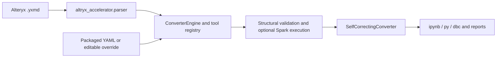

# Altryx Accelerator 1.1.0

Convert Alteryx `.yxmd` workflows into Databricks PySpark notebooks. The deterministic converter parses the workflow DAG, translates tools and expressions, checks the generated Python, and exports `.ipynb` and `.py` with a validation report. Optional Spark execution tests schemas and row counts against supplied sources.

**A structural PASS means generated operations passed static checks. It does not certify data parity.** Unsupported tools are reported, partial tools carry review warnings, and external sources must be mapped before running. Validate customer results against an Alteryx baseline before adopting generated pipelines.

## Install from the wheel

Python 3.9+; local Spark verification uses Python 3.11 and Java 17 with PySpark 3.5.3. Databricks Runtime 13.3 LTS or newer is required for the consumer notebooks.

```bash
python -m pip install https://github.com/aviral-bhardwaj/Altryx-Accelerator/releases/download/v1.1.0/altryx_accelerator-1.1.0-py3-none-any.whl
altryx-convert /path/to/workflows --batch --self-correct \
  --format ipynb,py --output-dir /tmp/migrated
```

The console script works from any directory. When using a checkout, `python /path/to/Altryx-Accelerator/convert.py ...` is a thin compatibility wrapper. Input paths are relative to your current directory; use absolute paths when running elsewhere. Both formats are the default. `.dbc` export is also available.

For development:

```bash
python -m venv .venv
source .venv/bin/activate
pip install -e '.[dev]'
python -m build
```

The wheel includes `altryx_accelerator/config/tool_mapping.yaml` and `source_tables.example.json`. Repo-root `config/tool_mapping.yaml` takes precedence in a source checkout; an explicit `ConverterEngine(tool_mapping_path=...)` overrides both. Python plugins can subclass `ToolConverter` and register tool names, or be referenced in the YAML mapping. Version 1.1.0 renames the old top-level package to `altryx_accelerator`; update application imports. The `pyspark_generator` and `validation` compatibility facades remain inside the new package.

## Install from Databricks Marketplace

Get the product and install its shared catalog. Import the notebooks supplied with the listing; no Git folder is required. Set `wheel_path` to the wheel in the installed shared Volume and `samples_dir` to its `samples` directory. Attach a UC-enabled cluster and Run All.

| Notebook | Purpose |
|---|---|
| `01_Skill_Mode_Alteryx_to_Databricks.ipynb` | Configure workflows, inspect the DAG, convert, validate, export |
| `02_Quickstart_Convert_Sample_Workflows.ipynb` | Convert all four shared samples and execute against explicitly synthetic test sources |
| `03_Map_Source_Tables_And_Run.ipynb` | Inspect external inputs, map them to UC tables and execute |
| `04_Batch_Migration_Job.ipynb` | Widget-driven batch conversion and job failure gate |

Each notebook installs the Volume wheel, falls back to the same-version GitHub Release wheel, then uses an embedded wheel when offline. The embedded copy is below 300 KB and requires the declared dependencies already installed. Python restarts after installation; later cells reload widgets and imports. Set `output_dir` to a writable Volume folder for durable outputs. The default `/tmp` path is suitable for exploration and is ephemeral.

Notebook and CLI defaults are `ipynb,py`. The bundle job explicitly selects `ipynb` because Workspace files with both extensions can collide on the same notebook name. A Volume output directory can hold both.

## Map source tables

Generated notebooks begin with a `SOURCE_TABLES` configuration cell (after the report/header). Every external input is listed by tool ID, with annotations and original paths in `SOURCE_LABELS`. Unresolved values are `None`, never inline `spark.table("TODO...")` calls. Edit the dictionary before Run All. Keys can be a tool ID, annotation substring or source-path substring; explicit IDs take priority.

```python
SOURCE_TABLES = {"12": "main.bronze.channel", "36": "main.bronze.field_remapping"}
```

Alternatively create `config/source_tables.json` from `config/source_tables.example.json` and pass it explicitly:

```bash
altryx-convert /path/to/workflow.yxmd --self-correct \
  --source-tables-config config/source_tables.json --output-dir /tmp/migrated
```

Notebook 01 also reads `config/source_tables.json` if present, or the JSON path in its `source_tables_config` widget. Notebook 04 uses that widget for jobs. Local `.yxdb` and Windows Excel sources cannot be read by Spark: migrate them to UC first. The customer sample's lookup workbook is not supplied; quickstart substitutes a clearly identified synthetic lookup solely for execution testing.

CSV and Parquet inputs on Spark-readable paths retain native readers. Output tools create temporary views; persistent writes are commented out for review. Uncomment and choose a target when ready.

## Conversion coverage and limitations

All tool types in the four shipped sample workflows have executable core translations: input, inline text, select, formula, filter, join, union, summarize, sort, DynamicRename and output. Browse is an inspection passthrough; TextBox/ToolContainer are annotations and do not count as missing transformations.

DynamicRename supports first data row, expression-based names using `[_CurrentField_]`, prefix/suffix addition/removal, case changes and right-input lookup rows/field names. Selected fields, exclusions and unknown fields are respected. First-row naming uses Spark's current row order; sort your source when the first row must be deterministic. Right-input rename lookups collect column-name mappings on the driver and should be small metadata tables.

Tools marked `partial` in `config/tool_mapping.yaml` remain limited: MultiRowFormula assumes a row order, DynamicInput needs an explicit source, and RunningTotal, TextToColumns, DateTime, MultiFieldFormula and FindReplace currently emit executable passthroughs with review warnings. GenerateRows emits an empty typed frame with a warning instead of fabricating 100 records. These are not complete semantic conversions; extend/review them before using such workflows in production.

Optional AI conversion is available with `pip install '.[ai]'` and `--mode ai`, using credentials from the environment. Deterministic mode needs no model account.



## Tests and committed outputs

```bash
python -I -m pytest tests/ -q
pip install pyspark==3.5.3
python -m pytest tests/ -q
python marketplace/publish.py --dry-run
```

Spark tests use `pytest.importorskip` when PySpark is absent; when installed, Java must be available. On macOS set JAVA_HOME to your Java 17 installation. The test fixture selects the same Python executable for Spark workers.

`tests/test_sample_workflows_output.py` regenerates `tests/output/<workflow>/` containing Python, notebooks and JSON reports. Cell IDs and source output are deterministic; timestamps are omitted. The Spark cases execute every generated sample with stub tables based on XML field metadata and assert terminal row counts and schemas. Separate tests verify actual filter/join/formula values and each DynamicRename mode. CI fails if regenerated tracked outputs drift.

```bash
pytest tests/test_sample_workflows_output.py -k test_sample_outputs -q
git diff --exit-code -- tests/output
```

## Publish and deploy

See [marketplace/PUBLISHING.md](marketplace/PUBLISHING.md) for the exact Private Exchange flow, required privileges, SDK upload script and public-provider prerequisites. Assets are four notebooks plus a shared UC Volume. Partner-listed Apps are not a delivery option.

```bash
SOURCE_DATE_EPOCH=1793232000 python -m build
python marketplace/build_notebooks.py
python marketplace/publish.py --dry-run
python marketplace/publish.py --profile marketplace --catalog main --schema marketplace
```

The optional developer bundle remains available:

```bash
databricks bundle validate -t dev
databricks bundle deploy -t dev
databricks bundle run alteryx_migration_job -t dev
```

Configure authentication through CLI profiles/environment. `databricks.yml` contains no workspace host. Set the job's `wheel_path`, input/output paths and source-table mappings for your environment. Runtime validation is opt-in; unmapped external sources are a prerequisite, not silently fabricated data.

Support: ardb40@gmail.com. Provider: Vrahad Analytics. MIT license; see LICENSE.
